# Cancan

**Biomedical Engineering (BME)** · Agentic AI Systems · Clinical Prediction Modeling

---

### AI-Based Agent & RAG

#### Engineering

- Developing an advertising compliance agent for internal use at Zhongshen Law Firm and building a venture around the project, with primary responsibility for full-stack development, deployment and operations.

#### Research

- **Multimodal Agents for Neurodevelopment** — Integrating MRI, EEG and behavioral data to explore individualized developmental assessment and caregiving support (ages 0–6).
- **Auditable LLM-assisted Food Matching** — Matching NHANES dietary data across USDA, FNDDS, FPED, FPID and Phenol-Explorer.

---

### Bioinformatics

- Combining machine learning and epidemiological modeling for heterogeneity-driven association studies across NHANES, KNHANES, UK Biobank, CHARLS, ELSA and ELSA-Brasil, while developing a framework for evaluating and governing AI-driven clinical prediction models.

---

### REM Lab

**Resonance · Embodiment · Musicality**

A self-founded research group exploring virtual character design, voice and musical expression through AI-driven workflows with Codex and Claude.

**Live2D · AI Voice · AI Singing** — From illustration, layering and rigging to character speech synthesis, vocal separation, voice conversion and mixing.

---

<!-- Stats + Streak -->

  

<!-- Activity Graph -->

